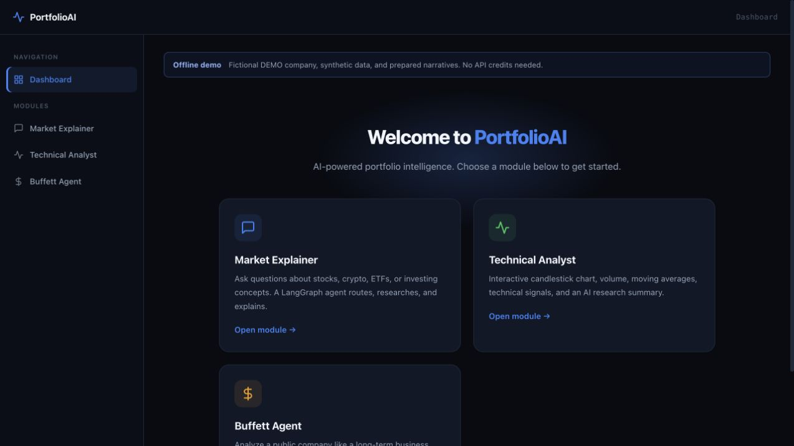
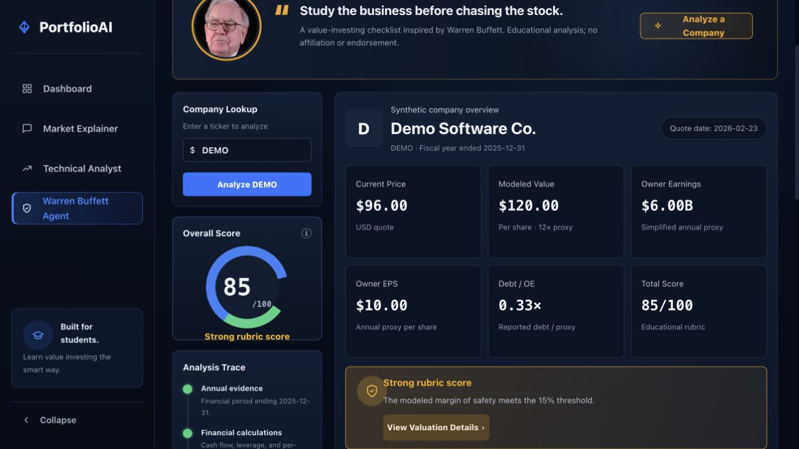
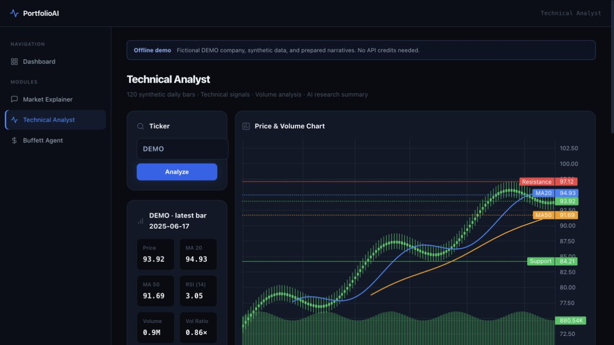
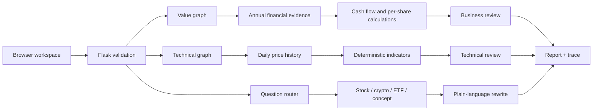

# PortfolioAI

A financial research workspace built with **Python, Flask, LangGraph, and Claude**. It combines deterministic calculations with structured narrative review and makes each workflow's inputs, steps, and limitations visible.

**Try it without an API key.** The default offline demo runs real graphs and calculations against a fictional company. Prepared narratives replace model calls, and every report is labeled as synthetic.



## What it demonstrates

| Workflow | Engineering focus | Output |
| --- | --- | --- |
| Value investing | Annual SEC facts, fiscal-period alignment, missing-data handling, validated model output | Per-share valuation heuristic, cash-flow and debt metrics, score breakdown |
| Technical analysis | Deterministic signal engine separated from language-model interpretation | Price chart, moving averages, RSI, returns, volatility, pivot levels, volume |
| Market explainer | Conditional LangGraph routing and a two-pass explanation workflow | Plain-language answer with retrieved evidence and source links |

The original dark dashboard, sidebar navigation, separate module screens, and Buffett report layout are retained. The technical chart includes interactive candlesticks, volume bars, MA20/MA50, and support/resistance overlays. Workflow traces, JSON downloads, responsive layouts, and clear missing-data messages connect those screens to the corrected backend. All page assets, including the chart library and portrait, are bundled locally; the demo makes no CDN or font requests.

## Run locally

Requires **Python 3.11 or 3.12**. From this repository's root:

```bash
python3 -m venv .venv
source .venv/bin/activate
python -m pip install -r requirements.txt
python app.py
```

On Windows, activate with `.venv\Scripts\activate` instead. Open **http://127.0.0.1:5000**. If the port is occupied, set `PORT=5055` in `.env` and restart.

No `.env` file is necessary for the demo. Installing dependencies requires internet access; running the demo does not.

### Two-minute walkthrough

1. Open **Buffett Agent**, then **Analyze DEMO**. The fictional DEMO company produces a $120 modeled value per share, 20% margin of safety, and an 85/100 illustrative rubric score.
2. Inspect the financial period, score breakdown, methodology, and workflow trace.
3. Open **Technical Analyst** and select **Analyze** to run the synthetic 120-bar price history.
4. Open **Market Explainer** and select **Explain** to see the prepared index-ETF explanation.
5. Use **Download JSON** to save the report, mode label, and trace.

Each demo is a fixed example. Real tickers are rejected in demo mode to prevent sample data being mistaken for real-company analysis. The market explainer always uses the displayed ETF example in demo mode.

<details>
<summary>Buffett dashboard preview</summary>



</details>

<details>
<summary>Technical analysis preview</summary>



</details>

## Optional live mode

Copy `.env.example` to `.env`, then configure:

```dotenv
DEMO_MODE=false
ANTHROPIC_API_KEY=your-key-here
ANTHROPIC_MODEL=claude-sonnet-4-6
SEC_USER_AGENT=YourApplication your-real-contact-email
```

Restart the app after changing configuration. The API key is used only on the server. Value analysis needs an SEC identity and a US filing company with supported US-GAAP annual facts and a USD quote. Technical and news workflows do not use SEC.

Live mode calls Anthropic (paid), SEC EDGAR, Yahoo Finance's unofficial chart endpoint, and Google News RSS. Model availability depends on the account. Network requests have timeouts; upstream failures return an error rather than fabricated results. Live integration paths are covered with simulated provider responses, but **real provider access and paid model calls have not been verified in this cleanup**.

This is a local demonstration application. Public hosting would need authentication, request throttling, provider caching/rate limiting, and a production application server before enabling paid live analysis for other users.

## Architecture



Demo and live providers are selected when each graph is constructed. Demo mode does not monkeypatch live clients or return pre-rendered API responses: it supplies synthetic evidence, executes graph nodes, and calculates results. Claude output is schema-validated for value and technical reports. The explainer preserves plain text and source URLs.

```text
app.py                    Flask app factory, validation, configuration, error handling
src/agents/               Value, technical, and conditional news workflows
src/core/                 Pure signal calculations and bounded model calls
src/data_access/          SEC, price, news, and synthetic demo providers
templates/                Original dashboard and module screens
static/                   Responsive styles and safe DOM rendering
tests/                    Offline regression and API tests
docs/                     Screenshots, methodology, project origins
.github/workflows/        GitHub Actions test workflow
```

## API

All analysis endpoints accept a JSON object and return JSON with `mode` and `trace` fields.

| Endpoint | Input | Main output |
| --- | --- | --- |
| `GET /health` | — | Status and mode |
| `POST /api/value` | `{"ticker":"DEMO"}` | `report` |
| `POST /api/technical` | `{"ticker":"DEMO"}` | `price_data`, `signals`, `report` |
| `POST /api/news` | `{"question":"What is an index ETF?"}` | `answer`, `context`, `sources` |

```bash
curl http://127.0.0.1:5000/api/value \
  -H 'Content-Type: application/json' \
  -d '{"ticker":"DEMO"}'
```

Responses distinguish invalid input (400), oversized requests (413), unavailable analysis or malformed model reports (422), upstream failures (502), and missing live configuration (503). Unexpected provider details are logged on the server and are not returned to the browser.

## Tests

```bash
python -m unittest discover -s tests -v
```

**40 tests pass on Python 3.12**, including complete demo graphs with network connections blocked, simulated live graph runs, annual-period selection, amendments, missing inputs, negative cash flow, zero RSI/volume, return intervals, malformed API payloads, and model-schema validation. GitHub Actions is configured for Python 3.11 and 3.12.

## Methodology and scope

The original interface has also been checked in a browser, including the chart, report dialogs, downloads, and mobile navigation.

See [methodology](docs/methodology.md) for formulas, score thresholds, and important data limitations. This project makes no claim of predictive accuracy, investment suitability, or backtested performance. It does not manage a real portfolio or execute trades.

This showcase evolved from the supplied AI portfolio course exercises. See [project origins and changes](docs/project-notes.md) for what was retained and improved.
